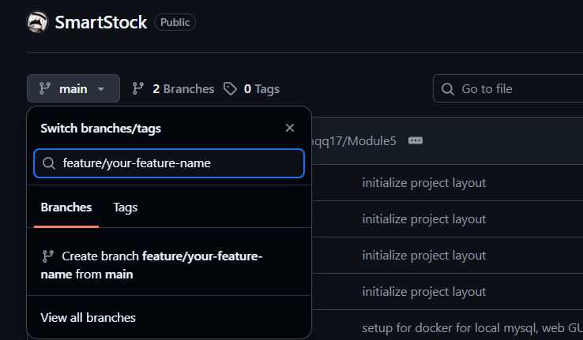

# SmartStock

Instructions/Cheatsheet  if u forgor 

Smart Inventory and Expiry Tracking System to Reduce Product Wastage in Food Manufacturing SMEs.
BITU 3923 Workshop 2, Group K27.

Stack: PHP 8.3 (Apache), MySQL 8, Docker, phpMyAdmin (dev only).

## Quick start

Requirements: [Docker Desktop](https://www.docker.com/products/docker-desktop/) and [Git](https://git-scm.com/download/win).

## Cloning the repo
Open terminal in the folder that you want the project to be save in and use the command
```bash
git clone https://github.com/Zulhaqq17/SmartStock.git smartstock 
cd smartstock
cp .env.example .env  # Copy example and create local .env configuration
docker compose up -d --build 
```


| Service | URL |
|---|---|
| Web app | http://localhost:8080 |
| phpMyAdmin | http://localhost:8081 |
| MySQL (from host) | `localhost:3307` |

Open http://localhost:8080. You should see "Database connection: OK", 8 tables and 5 sample batches ordered by expiry date.

Most of the stuff already been setup so its fine 

## Everyday commands

### 1. Docker Commands

```bash
docker compose up -d            # start
docker compose logs -f web      # watch PHP/Apache logs
docker compose down             # stop (keeps data)
docker compose down -v          # stop AND wipe the database (re-runs db/init/*.sql)
docker compose exec db mysql -u root -p smartstock   # MySQL shell
```

### 2. Daily Git Command (Aku pon selalu lupa)
#### Starting & Branching

```bash
git checkout main
git pull origin main  # Get the latest code from main
```
#### Create your branch on GitHub:


```bash
git fetch origin # Download new branch references from GitHub
git checkout feature/your-feature-name  # Switch to your new feature branch
git status # See what files you've changed or staged
```


#### Saving & Pushing Changes

```bash
git add . # Stage all changed files
git commit -m "feat: description of what you built" # Save your changes locally with a descriptive message
git push -u origin feature/your-feature-name # First push only (links local branch to remote)
git push # All future pushes on this branch
```

#### After PR Merged

```bash
git checkout main
git pull origin main # Switch back to main and update it
git branch -d feature/your-feature-name # Delete your old local branch
```
PHP files in `src/` are mounted into the container, so edit and refresh. No rebuild needed.

## Project structure

```
db/init/        SQL run automatically on first start (schema, then seed)
src/public/     Web root (index.php and page entry points)
src/config/     Shared config, e.g. database connection
docs/           Flowcharts, ERD (smartstock_erd.dbml), diagrams
.github/        Pull request template
```

## Database changes

`db/init/*.sql` only runs when the database volume is created. After editing a schema file, everyone runs:

```bash
docker compose down -v && docker compose up -d --build
```

Keep `docs/smartstock_erd.dbml` in sync with `01_schema.sql`.

## Git workflow

- `main` is always working. Nobody pushes to it directly.
- One branch per task: `feature/module-5-expiry-alerts`, `fix/login-redirect`.
- Small commits with clear messages: `feat: add FEFO batch query`, `fix: correct low-stock comparison`.
- Open a Pull Request into `main`; at least one teammate reviews before merging.
- Pull `main` before starting new work: `git pull origin main`.


## Modules

1. User Authentication and Access Management
2. Inventory and Product Management
3. Stock Entry and Batch Management
4. Stock Movement and Quantity Tracking
5. FEFO, Expiry and Low-Stock Alert Management
6. Inventory Dashboard and Reporting

## Rules

- Never commit `.env` or any password. Use `.env.example` for new variables.
- Use prepared statements (PDO) for every query that takes user input.
- Hash passwords with `password_hash()`.
- AI-assisted code must be tested, understood, and recorded in the AI Use Log.

## Troubleshooting

- Port already in use: change `WEB_PORT`, `PMA_PORT` or `DB_HOST_PORT` in `.env`.
- "Connection refused" right after start: MySQL needs a few seconds on first boot; refresh.
- Tables missing: the volume already existed. Run `docker compose down -v` and start again.
